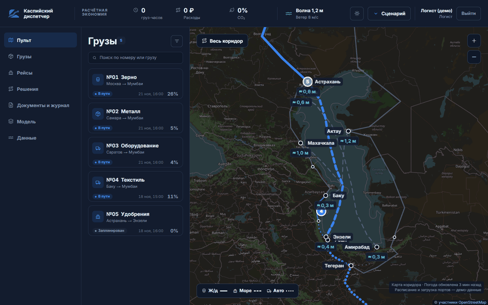
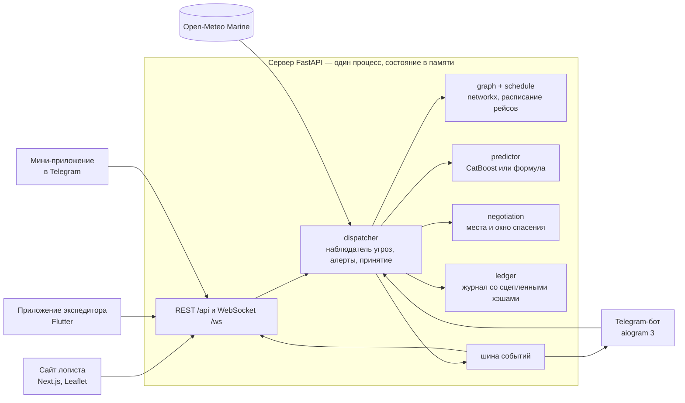
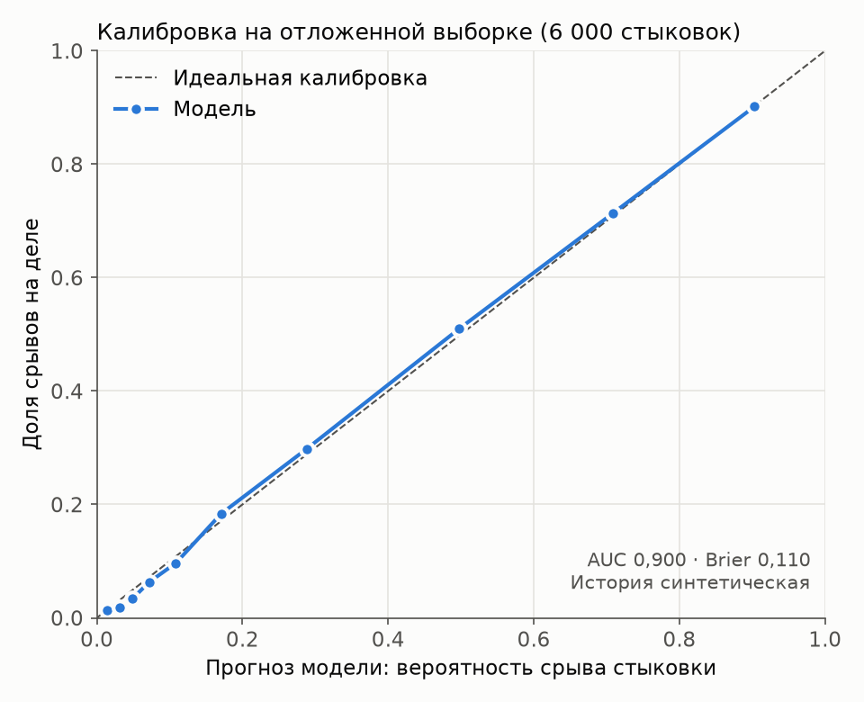
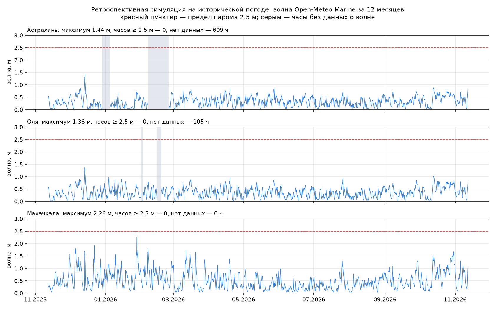

# Каспийский диспетчер

Система предупреждает логиста, что груз опоздает на паром через Каспий, и заранее предлагает готовый обходной маршрут.

Финал международного хакатона IV Каспийского цифрового форума (Махачкала), кейс «Smart Caspian Transit», трек «Цифровая экосистема МТК „Север–Юг“». Команда «СМАЙЛ», 5 человек, двое суток.




*Пульт логиста: спокойная обстановка → алерт «Лёд закроет переправу Астрахань — Энзели» → три груза перестроены через Махачкалу.*

## Проблема и решение

Паром из Астрахани в иранский Энзели ходит раз в 48 часов. Если отправление сдвигается на 18 часов, рейс отменяют, и груз ждёт следующий: задержка 18 часов превращается в 48. Система смотрит на прогноз на двое суток вперёд и находит грузы, у которых сорвётся стыковка с паромом. Для каждого она считает обход по графу маршрутов и расписанию рейсов и показывает цену бездействия в часах, рублях и CO₂. Решение принимает человек: одна кнопка «Принять» меняет маршрут, бронирует место на пароме и переоформляет пропуск.

## Что умеет

- **Наблюдатель угроз.** Каждые 30 минут сверяет расписание паромов с почасовым прогнозом волны Open-Meteo Marine на 48 часов. Угроза у рейса — алерт без нажатия кнопок.
- **Риск по каждому грузу.** Классификатор CatBoost даёт вероятность срыва стыковки. Код раскладывает задержку на факторы в часах: закрытие порта, очередь, таможня. Три главных признака модели объясняются через SHAP.
- **Альтернативные маршруты.** Граф коридора на networkx и расписание рейсов дают до трёх обходов. Каждый проверяется: волна в порту, место на пароме, окончание приёма, тип груза. У варианта — часы к плану, расчётная экономия в рублях и разница CO₂.
- **Принятие одной операцией.** Под одной блокировкой сервер заново проверяет место, бронирует его, меняет маршрут, выпускает новый пропуск, отзывает старый и пишет запись в журнал. Одновременные нажатия с сайта и из Telegram дают одно решение.
- **Согласование при нехватке мест** (сценарий «Лёд, мест мало»). Мест на пароме меньше, чем грузов. Код выбирает, кому дать место, по максимуму спасённых груз-часов. Цифровые модели порта, парома, таможни и железной дороги отвечают по простым правилам. Есть «окно спасения»: после срока вариант становится недоступен.
- **QR-пропуск и проверяемый журнал.** Пропуск — JWT с подписью HS256, внутри хэш документов и хэш записи журнала. Записи журнала сцеплены хэшами; эндпоинт проверки находит подменённую запись.
- **Один сервер, четыре клиента.** Сайт логиста, мобильное приложение экспедитора на Flutter, Telegram-бот и мини-приложение в Telegram. Все показывают один маршрут, один пропуск и одну расчётную экономию. События идут по WebSocket, в приложение — пуши FCM.
- **Живые значки на карте.** Сервер считает положение груза на линии маршрута по расписанию этапов. Есть ускоренный просмотр ×60 / ×600: он двигает только значки, статусы и деньги не меняются.

## Числа главного сценария

Сценарий «Лёд на Северном Каспии»: три груза (120 т) идут на паром Астрахань → Энзели, канал закрыт для проводки.

| | Ничего не делать | Через Махачкалу |
|---|---|---|
| Прибытие к плану | +48 ч | +6 ч |
| Стоимость задержки по трём грузам | 720 тыс ₽ | 123 тыс ₽ (с доплатой за перевозку) |
| Расчётная экономия | — | **597 тыс ₽**, 126 груз-часов, −6,9% CO₂ |

Ставка 125 ₽ за тонну в час — условная стоимость часа задержки, допущение для демо. Расчёт по шагам — [docs/DEMO_SCENARIO.md](docs/DEMO_SCENARIO.md).

## Архитектура



- **Числа считает код, а не LLM.** Вероятность даёт модель, маршруты — граф, часы, рубли и CO₂ — формулы. Текст алерта собирается из шаблона по готовым числам. LLM подключается только для свободных вопросов в боте и только при заданном ключе; без него всё работает.
- **Состояние в памяти** из `data/seed.json`. Сброс демо возвращает его к началу, повторный прогон даёт те же числа.
- **События через шину.** Изменение груза, алерта или журнала уходит одним событием на WebSocket, в Telegram-бот и в пуши FCM.
- **networkx вместо графовой БД** и **цепочка хэшей вместо распределённого реестра**: за двое суток важнее сквозной сценарий, чем инфраструктура. Журнал хранится у одного оператора. Подмену записи он показывает, но от самого оператора не защищает.

## Стек

| Слой | Технологии |
|---|---|
| Сервер | Python 3.11+, FastAPI 0.115, Uvicorn 0.32, Pydantic 2.13, networkx 3.4, PyJWT 2.10, cryptography |
| Модель | CatBoost 1.2, numpy; обучение — pandas 3.1, scikit-learn 1.9, matplotlib 3.11 |
| Сайт | Next.js 16.4 (статический экспорт), React 19.3, TypeScript 5, Tailwind CSS 4.3, Leaflet 1.9 |
| Мобильное приложение | Flutter (Dart 3.13), http, camera, image_picker, qr_flutter, firebase_messaging |
| Telegram | aiogram 3.31, мини-приложение на чистом HTML, CSS и JS |
| Данные | Open-Meteo Marine (волна), Open-Meteo Forecast (ветер), OpenStreetMap (подложка карты) |
| Тесты и выкатка | pytest 8.3, httpx; GitHub Actions, Caddy, systemd |

## Модель

**Что предсказывает.** Вероятность, что груз не успеет на свой паром. Признаки: волна, ветер, загрузка порта, очередь на таможне, запас времени до окончания приёма, месяц, день недели, тип груза, порт, лёд. Сдвиг отправления и задержку прибытия в часах считает код по прогнозу и расписанию, а не модель.

**На чём обучена.** На синтетической истории: 30 000 стыковок, сгенерированных по правилам ([`scripts/gen_history.py`](backend/scripts/gen_history.py), seed 42). Волна до 2 м не влияет, от 2 до 3,5 м задержка растёт, выше паром стоит; загрузка порта влияет нелинейно после 0,8; таможня — логнормальная; есть шум и выбросы. Настоящей истории стыковок у команды не было.

**Метрики** на отложенной выборке (6 000 стыковок, из [`data/model_report.json`](backend/data/model_report.json)): AUC 0,900, Brier 0,110. Регрессор сдвига отправления (MAE 4,35 ч) обучен только для проверки, на сервере не используется. Метрики показывают, что конвейер работает. О точности на реальных данных они ничего не говорят.



**Переобучить** (из `backend/`, нужны зависимости из `requirements-dev.txt`):

```bash
python scripts/train.py --regen   # пересоздать историю генератором и обучить
python scripts/train.py           # обучить на существующем data/history.csv
```

Таблица `data/history.csv` — по строке на стыковку, столбцы: `wave_height_m, wind_ms, port_congestion, customs_queue_h, buffer_hours, month, weekday, cargo_type, port_id, ice, departure_shift_h, missed_connection`. Скрипт пишет модели, отчёт с метриками и графики, а в конце прогоняет сценарий через движок и падает, если вероятности вышли за допуск. На истории реального порта модель переобучается без изменения кода.

## Данные: что настоящее, что учебное

| Данные | Откуда | Статус |
|---|---|---|
| Прогноз волны и ветра на 7 дней | Open-Meteo Marine и Forecast, раз в 30 минут | настоящие |
| Волна за 12 месяцев для ретроспективы | архив Open-Meteo Marine | настоящие |
| Координаты узлов, длины рёбер | OpenStreetMap, сверка длин по координатам | настоящие |
| Факты о портах Махачкала и Астрахань | публикации, ссылки в `seed.json` и в разделе «Данные» на сайте | настоящие |
| Расписание и вместимость паромов | задано для демо | учебные |
| Тарифы, коэффициенты CO₂, ставка простоя | ориентиры, ставка 125 ₽/т·ч условная | учебные |
| Лёд на Волго-Каспийском канале | задан вручную по историческим срокам ледокольных проводок | учебные |
| Положение грузов | по плановому расписанию этапов | учебные |
| История стыковок для модели | сгенерирована | синтетические |

**Почему главный сценарий — лёд, а не шторм.** Сначала демо строилось вокруг шторма: волна 3,4 м у Астрахани закрывает порт, паром не выходит. Перед финалом мы прогнали ретроспективную симуляцию ([`scripts/backtest.py`](backend/scripts/backtest.py)) на настоящей почасовой волне Open-Meteo Marine за 12 месяцев, с ноября 2025 по ноябрь 2026. Правило закрытия то же, что у наблюдателя угроз: волна в порту в момент отправления не ниже 2,5 м. Результат: волны 2,5 м не было ни в одном порту. Максимум у Астрахани — 1,44 м, у Оли — 1,36 м, у Махачкалы — 2,26 м. Из 180 условных отправлений ни одно не закрылось бы по волне. Шторм 3,4 м у Астрахани оказался бы выдумкой. При этом у Астрахани 609 часов без данных о волне, 435 из них — в феврале. Open-Meteo причину не сообщает, но зимой мелководный Северный Каспий обычно покрыт льдом. Астрахань — замерзающий порт, выход в море идёт по Волго-Каспийскому каналу около 188 км, а в сезон 2022/23 ледоколы провели 690 судов. Махачкала — единственный незамерзающий глубоководный порт России на Каспии. Поэтому главный сценарий стал ледовым: лёд закрывает канал, а обход идёт через Махачкалу. Шторм остался стресс-тестом с подписью «за 12 месяцев волна у Астрахани не превышала 1,44 м». Числа часов и денег от этого не изменились: лёд подаётся в расчёт через те же входы, что и шторм.



*Волна за 12 месяцев у трёх портов. Красный пунктир — предел парома 2,5 м, серым — часы без данных.*

## Запуск локально

Нужны Python 3.11+ и Node.js 20+.

**Сервер** (из `backend/`):

```bash
python -m venv .venv
.venv/Scripts/python -m pip install -r requirements.txt   # macOS/Linux: .venv/bin/python
cp .env.example .env
.venv/Scripts/python -m uvicorn app.main:app --port 8000
```

То же одной командой — `./run.sh` или `.\run.ps1`. Сервер слушает `http://localhost:8000`, документация API — `http://localhost:8000/docs`. Ключ для заголовка `X-API-Key` — `API_KEY` из `.env` (в `.env.example` — `caspian-dev-key`, только для локального запуска). Без `BOT_TOKEN` сервер работает без Telegram-бота, без `LLM_API_KEY` — без свободных вопросов в боте. `WEATHER_MODE=synthetic` отключает обращения к Open-Meteo.

**Тесты** (из `backend/`, после `cp .env.example .env` — без `.env` часть тестов падает):

```bash
.venv/Scripts/python -m pip install -r requirements-dev.txt
.venv/Scripts/python -m pytest
```

**Сайт** (из `website/`):

```bash
npm ci
npm run dev
```

Без настроек сайт работает на моках из `src/mocks`. Чтобы подключить локальный сервер, создайте `website/.env.local`:

```
NEXT_PUBLIC_API_URL=http://localhost:8000
NEXT_PUBLIC_API_KEY=caspian-dev-key
```

Сайт откроется на `http://localhost:3000`. Войти можно кнопками «Демо-вход» или зарегистрироваться на экране входа; демо-аккаунты создаются при первом запуске сервера.

**Мобильное приложение** — Flutter, подключение и контракт описаны в [docs/FLUTTER_CONTRACT.md](docs/FLUTTER_CONTRACT.md). Адрес сервера и ключ задаются в `mobile/.env` по образцу `mobile/.env.example`.

Подробности для разработки — [docs/DEVELOPMENT.md](docs/DEVELOPMENT.md) и [backend/README.md](backend/README.md).

## Структура репозитория

```
backend/            сервер FastAPI
  app/              диспетчер, граф, расписание, предиктор, согласование, журнал, погода, бот
  app/miniapp/      мини-приложение Telegram (статика)
  data/             сид демо, модель CatBoost, отчёт о модели, история, ретроспектива
  scripts/          генерация истории, обучение, ретроспектива, моки, выкатка
  tests/            тесты pytest
website/            сайт логиста на Next.js
mobile/             приложение экспедитора на Flutter
docs/               сценарий демо, контракт для Flutter, план, макеты, снимки для питча
CLAUDE.md           архитектура, модель данных и контракт API — главный документ команды
.github/workflows/  выкатка на сервер
```

## Чего система не умеет

- Нет интеграции с портами, таможней и операторами паромов. Расписание, места и положение грузов — демо-данные. Пропуск — внутренний пропуск сервиса, порт его не принимает.
- Модель обучена на синтетической истории. На реальных данных её точность не проверялась.
- Журнал ведёт один оператор. Подмену записи он показывает, но от самого оператора защищает только копия пропуска у экспедитора.
- Ледовой обстановки в реальном времени нет: лёд в сценарии задан вручную.
- Распознавания документов нет: вместо фото инвойса подставляется заранее подготовленный черновик полей.

## Команда и роли

| Участник | Роль |
|---|---|
| Гаджилаев М. | капитан, мобильное приложение |
| Сидиков С. | тимлид, спикер, бэкенд |
| Гаджиев А. | аналитик данных |
| Абакаров М. | фронтенд |
| Зайнулабидов М. | дизайн |

Проект разрабатывался с ИИ-ассистентами. Архитектуру, сценарий и проверку вела команда.

## Статус

Демо-стенд выключен после хакатона. Видео показа: будет добавлено.
